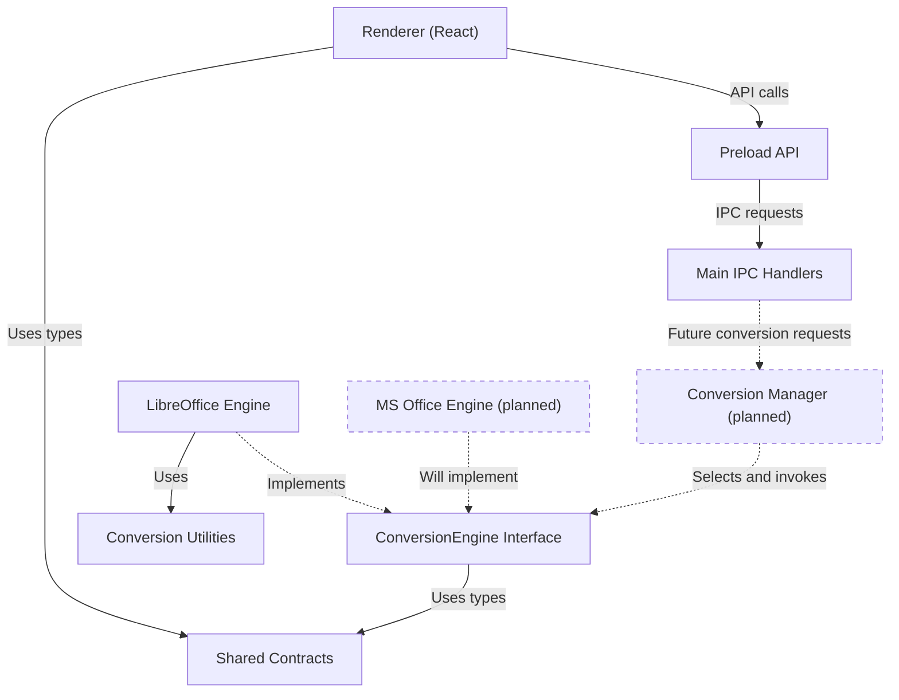

# Architecture

## 1. Overview

File converter is a electron based application, it aims to convert files to different formats using multiple engines.

Current implementation supports Docx,Pptx,Xlsx files to pdf using Libre office.

Application is organize into three layers:

- Main Process: Manages application lifecycle, cross-platform interactions, and backend logic.

- Preload: Consists an API for letting renderer and main process communicate.

- Renderer: Frontend layer using React and Tailwind.

Shared TypeScript interfaces define contracts for application wide components

Responsibility of each adapter engine is to handle conversions

Intended responsibility of manager is to handle batch conversions

## 2. High-Level Architecture

The application separates user interface and backend operations using Electron's process architecture.

### **Renderer**

The renderer uses React + Tailwind to provide user interface. It request information through the API exposed by preload.

### **Preload**

The preload exposes selected capabilities to renderer and ipcRenderer using contextBridge.

### **Main Process**

The main process manages, application lifecycle and handles operating system specific capabilities.

It contains conversion system, including:

- Conversion Engines
- Shared Utilities
- Conversion manager

### **Communication**

Communication between renderer and main process fallows this:

1. Renderer calls an exposed API method.
2. Preload forwards request trough IPC.
3. A handler in the main process performs the operation.
4. The result is returned through the same sequence.

Currently IPC integration is empty.

## 3. Component Responsibilities

### 3.1 Conversion Manager (Planned)

Conversion manager will coordinate requests and select appropriate engines.

Responsibilities:

- Managing batch conversions.
- Selecting eligible engines depending on format support and availability.
- Selecting the engine according to user settings.
- Using Libre office as default engine
- Coordinating conversions, results, failures
- Producing batch result

Manager will flow _best-effort_ execution policy, {Independent failures doesn't crash the process}

LibreOffice is the default preferred conversion engine, users would be able to configure preferred engine

## 4. Conversion Workflow

## 5. Design Constraints

## 6. Planned Architecture
