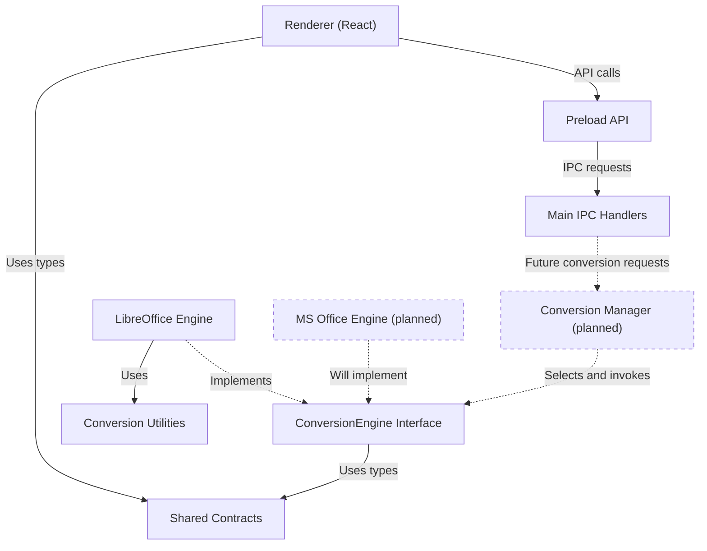
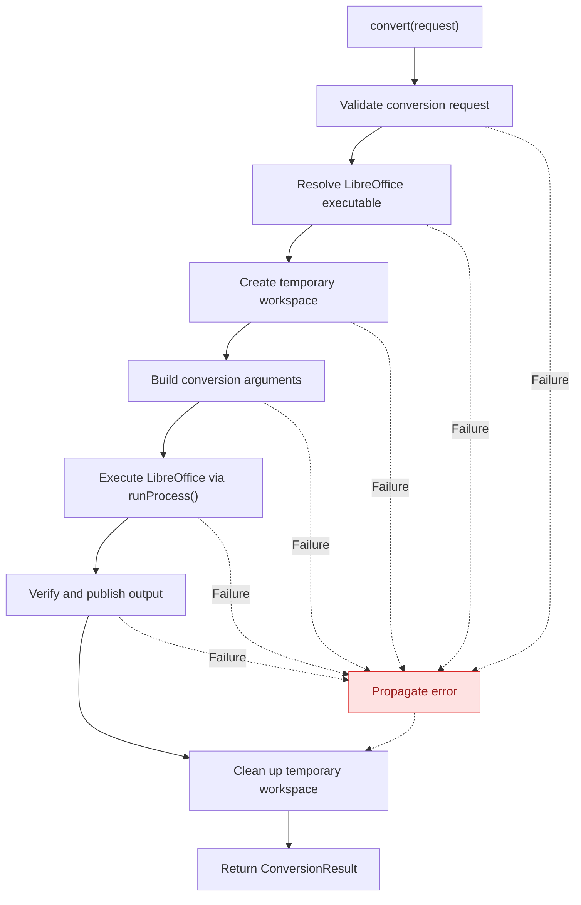

# Architecture

## 1. Overview

File converter is a electron based application, it aims to convert files to different formats using multiple engines.

Current implementation supports Docx,Pptx,Xlsx files to pdf using Libre office.

Application is organize into three layers:

- Main Process: Manages application lifecycle, cross-platform interactions, and backend logic.

- Preload: Consists an API for letting renderer and main process communicate.

- Renderer: Frontend layer using React and Tailwind.

Shared TypeScript interfaces define contracts for application wide components

Responsibility of each adapter engine is to handle conversions

Intended responsibility of manager is to handle batch conversions

## 2. High-Level Architecture

The application separates user interface and backend operations using Electron's process architecture.

### **Renderer**

The renderer uses React + Tailwind to provide user interface. It request information through the API exposed by preload.

### **Preload**

The preload exposes selected capabilities to renderer and ipcRenderer using contextBridge.

### **Main Process**

The main process manages, application lifecycle and handles operating system specific capabilities.

It contains conversion system, including:

- Conversion Engines
- Shared Utilities
- Conversion manager

### **Communication**

Communication between renderer and main process fallows this:

1. Renderer calls an exposed API method.
2. Preload forwards request trough IPC.
3. A handler in the main process performs the operation.
4. The result is returned through the same sequence.

Currently IPC integration is empty.

## 3. Component Responsibilities

### 3.1 Conversion Manager (Planned)

Conversion manager will coordinate requests and select appropriate engines.

Responsibilities:

- Managing batch conversions.
- Selecting eligible engines depending on format support and availability.
- Selecting the engine according to user settings.
- Using Libre office as default engine
- Coordinating conversions, results, failures
- Producing batch result

Manager will flow _best-effort_ execution policy, {Independent failures doesn't crash the process}

LibreOffice is the default preferred conversion engine, users would be able to configure preferred engine

### 3.2 Conversion Engines

Conversion engines are responsible for executing individual file conversions.

Each engine implements ConversionEngine interface, providing common contract for availability checks and format compatibility.

Interface defines three operations:

- isAvailable(): Determines if conversion software available.
- supports(): Determines if source and target combination is supported.
- convert(): Processes the conversion request and produces the result.

Each engine is responsible for validating requests, handling engine-specific failures, and managing temporary resources.

Engines use shared utilities for file validation, process execution, and output publishing.

#### Current implementations:

- LibreOffice engine: Supports Docx, Pptx, and Xlsx to Pdf conversions.
- Ms Office Engine: Planned, intended to provide additional conversion backend for windows.

### 3.3 Shared Utilities

Conversion system uses shared utilities to provide reusable functionality and avoid duplicating logic.

Utilities responsible for performing specific operations without managing overall conversion flow.

Current utility layer consists of:

- Process Runner: Executes and supervises external processes, including termination and output collection.
- File Validation: Validates conversion requests.
- Output Publishing: Publishes generated files to their final destinations.
- LibreOffice Discovery: Locates and verifies LibreOffice.

Conversion manager shouldn't know how internal utility operations are performed.

## 4. Conversion Workflow

Conversion system designed to execute individual conversion requests.

Currently, only LibreOffice engine is implemented and batch processing is yet to get implemented.

### 4.1 Conversion

LibreOffice engine processes conversion requests in this sequence:

1. **Validation:** Validate the request via supported formats, input conditions, and output destination.
2. **Executable Discovery:** Locate LibreOffice executable path.
3. **Workspace Creation:** Create a temporary workspace inside output directory.
4. **Process Execution:** Construct LibreOffice cli commands to execute conversion.
5. **Output Publishing:** Verify and publish the generated file.
6. **Cleanup:** Remove the temporary workspace regardless of conversion succeeds.
7. **Return Result:** Return a ConversionResult when conversion succeeds.

#### Temporary workspace location:

The engine creates its temporary workspace inside the requested output directory to ensure that temporary and final output files reside on the same filesystem. This allows the output publishing utility to use hard links without copying file contents. Removing the temporary workspace afterward does not delete the published output because its directory entry remains linked to the underlying file.

### 4.2 Error Handling

Individual conversion errors propagate to caller.

Engine is responsible for cleaning up the temporary resources when execution or publishing fails.

The planned conversion manager will handle these failures at the batch level according to the best-effort execution policy described in ADR-001.

## 5. Design Constraints

## 6. Planned Architecture