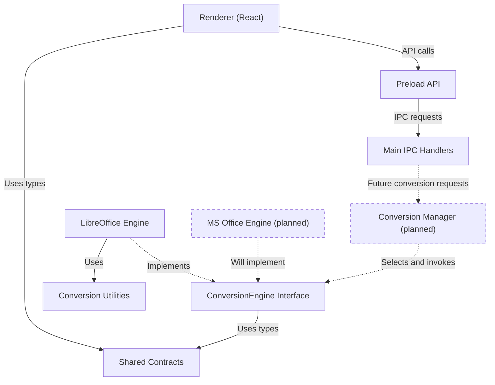
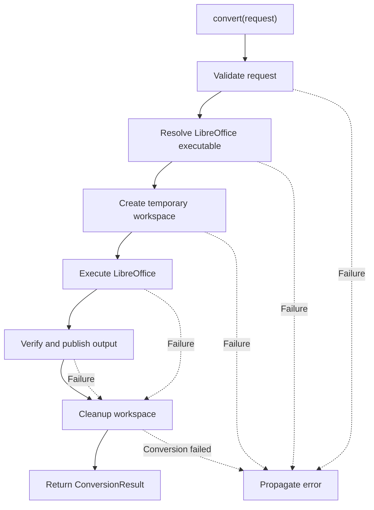
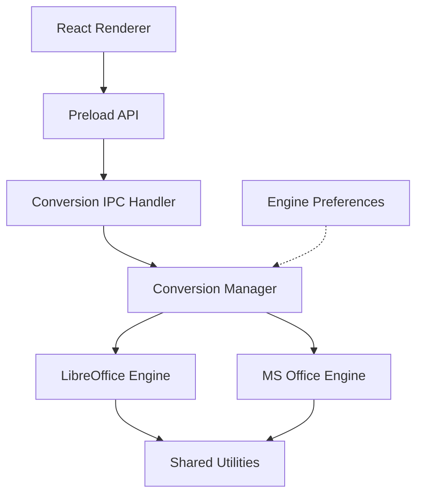

# Architecture

## 1. Overview

File converter is a electron based application, it aims to convert files to different formats using multiple engines.

Current implementation supports Docx,Pptx,Xlsx files to pdf using Libre office.

Application is organize into three layers:

- Main Process: Manages application lifecycle, cross-platform interactions, and backend logic.

- Preload: Consists an API for letting renderer and main process communicate.

- Renderer: Frontend layer using React and Tailwind.

Shared TypeScript interfaces define contracts for application wide components

Responsibility of each adapter engine is to handle conversions

Intended responsibility of manager is to handle batch conversions

## 2. High-Level Architecture

The application separates user interface and backend operations using Electron's process architecture.

### **Renderer**

The renderer uses React + Tailwind to provide user interface. It request information through the API exposed by preload.

### **Preload**

The preload exposes selected capabilities to renderer and ipcRenderer using contextBridge.

### **Main Process**

The main process manages, application lifecycle and handles operating system specific capabilities.

It contains conversion system, including:

- Conversion Engines
- Shared Utilities
- Conversion manager

### **Communication**

Communication between renderer and main process fallows this:

1. Renderer calls an exposed API method.
2. Preload forwards request trough IPC.
3. A handler in the main process performs the operation.
4. The result is returned through the same sequence.

Currently IPC integration is empty.

## 3. Component Responsibilities

### 3.1 Conversion Manager (Planned)

Conversion manager will coordinate requests and select appropriate engines.

Responsibilities:

- Managing batch conversions.
- Selecting eligible engines depending on format support and availability.
- Selecting the engine according to user settings.
- Using Libre office as default engine
- Coordinating conversions, results, failures
- Producing batch result

Manager will flow _best-effort_ execution policy, {Independent failures doesn't crash the process}

LibreOffice is the default preferred conversion engine, users would be able to configure preferred engine

### 3.2 Conversion Engines

Conversion engines are responsible for executing individual file conversions.

Each engine implements ConversionEngine interface, providing common contract for availability checks and format compatibility.

Interface defines three operations:

- isAvailable(): Determines if conversion software available.
- supports(): Determines if source and target combination is supported.
- convert(): Processes the conversion request and produces the result.

Each engine is responsible for validating requests, handling engine-specific failures, and managing temporary resources.

Engines use shared utilities for file validation, process execution, and output publishing.

#### Current implementations:

- LibreOffice engine: Supports Docx, Pptx, and Xlsx to Pdf conversions.
- Ms Office Engine: Planned, intended to provide additional conversion backend for windows.

### 3.3 Shared Utilities

Conversion system uses shared utilities to provide reusable functionality and avoid duplicating logic.

Utilities responsible for performing specific operations without managing overall conversion flow.

Current utility layer consists of:

- Process Runner: Executes and supervises external processes, including termination and output collection.
- File Validation: Validates conversion requests.
- Output Publishing: Publishes generated files to their final destinations.
- LibreOffice Discovery: Locates and verifies LibreOffice.

Conversion manager shouldn't know how internal utility operations are performed.

## 4. Conversion Workflow

Conversion system designed to execute individual conversion requests.

Currently, only LibreOffice engine is implemented and batch processing is yet to get implemented.

### 4.1 Conversion

LibreOffice engine processes conversion requests in this sequence:

1. **Validation:** Validate the request via supported formats, input conditions, and output destination.
2. **Executable Discovery:** Locate LibreOffice executable path.
3. **Workspace Creation:** Create a temporary workspace inside output directory.
4. **Process Execution:** Construct LibreOffice cli commands to execute conversion.
5. **Output Publishing:** Verify and publish the generated file.
6. **Cleanup:** Remove the temporary workspace regardless of conversion succeeds.
7. **Return Result:** Return a ConversionResult when conversion succeeds.

#### Temporary workspace location:

The engine creates its temporary workspace inside the requested output directory to ensure that temporary and final output files reside on the same filesystem. This allows the output publishing utility to use hard links without copying file contents. Removing the temporary workspace afterward does not delete the published output because its directory entry remains linked to the underlying file.

### 4.2 Error Handling

Individual conversion errors propagate to caller.

Engine is responsible for cleaning up the temporary resources when execution or publishing fails.

Temporary workspace cleanup is performed in a finally block after successful workspace creation. Failures occurring before workspace creation propagate directly without entering the workspace cleanup path.

The planned conversion manager will handle these failures at the batch level according to the best-effort execution policy described in [ADR-001](decisions/001-batch-failure-policy.md).

## 5. Design Constraints

The following constraints define the intended boundaries of the application. Future implementations and refactoring should preserve these properties unless an architectural decision explicitly changes them.

### 5.1 Process Isolation

The renderer must access privileged functionality through exposed preload APIs.

The main process is responsible for validating and handling privileged requests received through IPC.

Backend implementation details must not be directly exposed to the renderer.

### 5.2 Separation of Responsibilities

The conversion manager is responsible for orchestration, engine selection, and batch-level result handling.

Conversion engines are responsible for executing and validating individual conversions.

Shared utilities provide reusable operations without managing the overall conversion workflow.

### 5.3 Engine Independence

Conversion engines must remain usable independently of the conversion manager.

Each engine must fulfill its own conversion contract, including request validation, resource cleanup, and failure reporting.

Engines must not depend on user interface components or batch-level orchestration logic.

### 5.4 Dependency Direction

Lower-level utilities must not depend on the conversion engines or manager that consume them.

Shared contracts should remain independent of backend implementation details.

Dependencies should follow component responsibilities rather than introducing unnecessary coupling between unrelated modules.

### 5.5 Failure Isolation

A failure in an conversion must not terminate other independent conversions within a batch.

The manager must preserve individual outcomes, including failures, and provide an aggregated result.

Logging must not serve as the sole mechanism for reporting conversion outcomes.

#### Batch Output Conflicts

The conversion manager must detect requests within the same batch that resolve to an identical output destination.

The manager follows a _reject-all-conflicting_ policy:

- Every request involved in an output destination conflict is rejected.
- Unrelated requests continue processing according to the best-effort execution policy.
- The manager reports rejected requests individually as part of the batch result.
- Individual engines remain responsible for validating their own conversion requests.
- The output publishing utility independently enforces filesystem-level collision protection.

Conflict detection must occur before executing the affected requests to prevent request ordering from determining the outcome.

### 5.6 Resource Management

Conversion engines are responsible for releasing temporary resources created during execution.

Temporary conversion output must be verified before being published to its final destination.

Errors occurring during process execution, output publishing, or cleanup must be handled without incorrectly reporting a failed conversion as successful.

## 6. Planned Architecture

This section describes planned components and integrations that are not yet implemented. These designs may evolve during development, provided they respect the established architectural constraints.

### 6.1 Conversion Manager

The conversion manager will coordinate batches of independent conversion requests.

Planned functionality includes:

- Selecting eligible engines according to availability, format compatibility, and user preferences.
- Coordinating the execution of individual conversion requests.
- Detecting and rejecting requests with conflicting output destinations.
- Continuing unaffected conversions when individual operations fail.
- Aggregating conversion outcomes into a batch-level result.
- Reporting engine fallback information to the calling layer.

The manager's execution model, including concurrency limits and cancellation behavior, has not yet been finalized.

### 6.2 MS Office Engine

A Windows-specific conversion engine is planned to provide an alternative to LibreOffice.

The MS Office engine will implement the existing `ConversionEngine` interface and remain independently usable.

LibreOffice will remain the default engine. MS Office will be selectable through application preferences when available and compatible.

### 6.3 IPC Integration

Conversion-related IPC communication will connect the renderer to the conversion manager through the preload API.

The intended communication flow is:

1. The renderer submits conversion requests through the exposed API.
2. Preload forwards the requests through IPC.
3. The main process validates the IPC request and delegates conversion orchestration to the manager.
4. The manager coordinates conversion engines and collects results.
5. The results are returned to the renderer for presentation.

The renderer must not directly invoke conversion engines or access backend implementation details.

### 6.4 Application Settings

Application settings will allow users to select a preferred conversion engine.

LibreOffice will be the default preference.

If the preferred engine is unavailable or incompatible with a requested conversion, the manager will attempt to use another eligible engine.

Fallback information will be communicated to the renderer so the user can be notified without modifying the saved preference.

The storage mechanism and configuration interface have not yet been designed.

### 6.5 Planned Component Integration

The diagram represents the intended dependencies, not the currently implemented conversion path.
